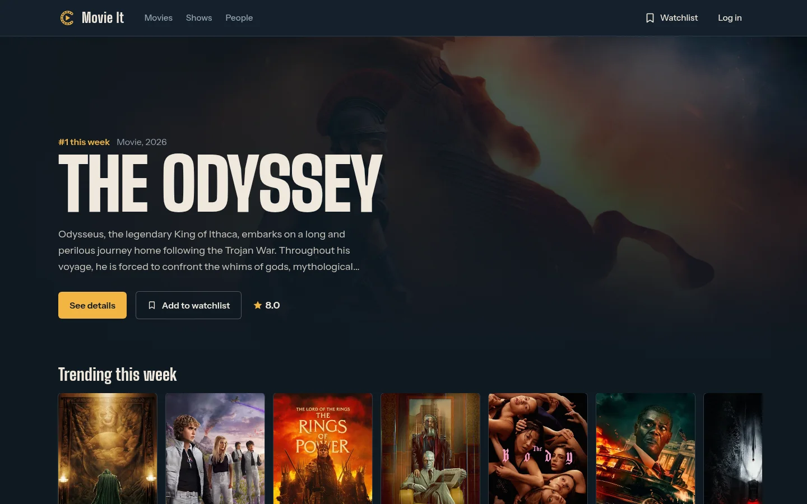
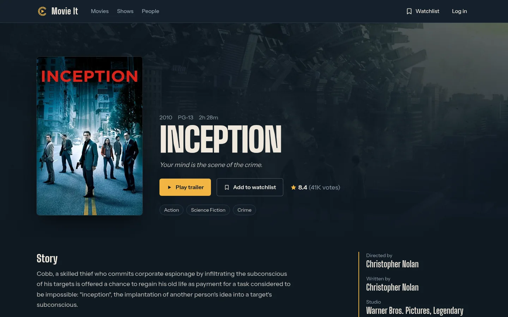
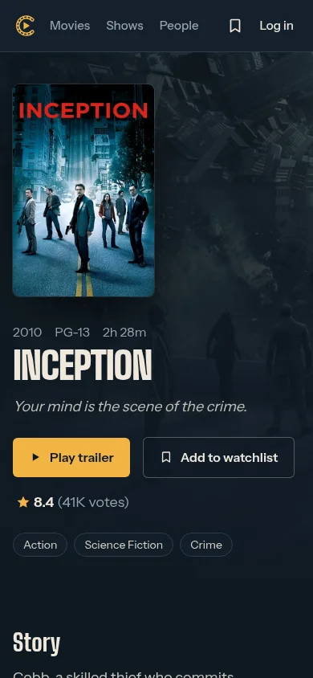
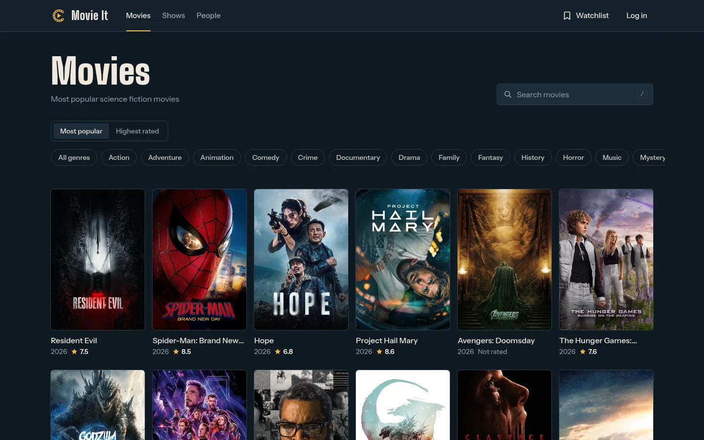
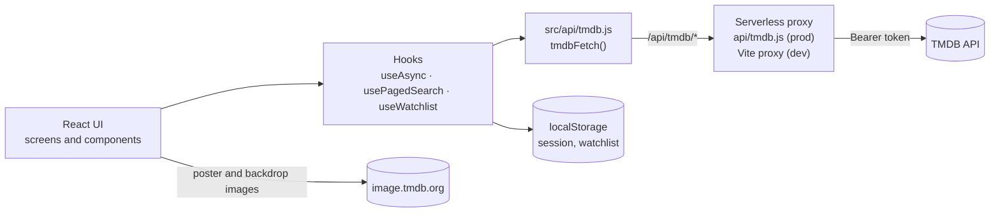

<div align="center">


# Movie It

**Find your next movie or show.** Browse what's trending, dig into cast and crew, watch trailers, and keep a watchlist, all powered by the TMDB API.

<!-- LIVE_DEMO -->

[](https://github.com/Ameer-Hassoon/movie-it/actions/workflows/ci.yml)


[](LICENSE)



</div>

## Features

- **Discover**: a home page led by this week's #1 title, with rows for trending, popular and highest-rated movies and shows.
- **Browse and search** movies, shows and people, with search-as-you-type, genre filters, sorting and "Show more" paging. Filters and searches live in the URL, so any view can be shared or bookmarked.
- **Details pages**: backdrop hero, age rating, runtime, director and writers, the full cast, and "More like this" recommendations.
- **Trailers** play in a modal without leaving the page.
- **People**: biography, birth details, and every movie and show they appear in, sorted by popularity.
- **Watchlist**: save titles from anywhere. It is kept per account and stays in sync across browser tabs.
- **Accounts**: sign up, log in and protected routes (demo auth, see [Notes](#notes)).
- **Responsive and accessible**: works from 360 px phones to wide desktops, full keyboard support, visible focus, a skip link, semantic landmarks, and reduced-motion support.

<table>
  <tr>
    <td width="68%"></td>
    <td width="32%"></td>
  </tr>
  <tr>
    <td colspan="2"></td>
  </tr>
</table>

## Engineering highlights

| | |
|---|---|
| **The API token never reaches the browser** | The app calls its own `/api/tmdb/*` endpoint. In production that is a Vercel serverless function; in development, a Vite proxy. Either way the token is attached on the server. The function only forwards allow-listed TMDB paths, so it can't be used as an open proxy, and it sets CDN cache headers so repeat requests are cheap. |
| **No race conditions** | Every request gets an `AbortController`. Typing a new search cancels the old one, so a slow response can never overwrite a newer result. |
| **Fewer requests** | Each details page is a single request using TMDB's `append_to_response`, instead of four sequential calls. |
| **Small, reusable pieces** | One `BrowsePage` drives Movies, Shows and People. One `TitleDetails` drives movie and show pages. Data access is isolated in `src/api` and custom hooks (`useAsync`, `usePagedSearch`, `useDebounce`, `useWatchlist`). |
| **Design system** | Color, type and spacing tokens are defined once in Tailwind's `@theme`. Loading skeletons, error states with retry, and empty states are shared components. |
| **Tested and checked on every push** | Vitest and Testing Library cover the helpers, hooks, watchlist, auth and the serverless function. GitHub Actions runs lint, tests and a production build on every push and pull request. |

## Architecture



```
api/tmdb.js            Serverless proxy (Vercel)
src/
  api/                 TMDB client + pure helpers (year, certification, trailer pick…)
  hooks/               useAsync, usePagedSearch, useDebounce
  context/             Auth and Watchlist providers + hooks
  components/          BrowsePage, TitleDetails, PosterCard, MediaRow, TrailerModal…
  screens/             One file per route
  index.css            Design tokens (Tailwind @theme)
```

## Getting started

You need Node 20+ and a free TMDB account.

```bash
git clone https://github.com/Ameer-Hassoon/movie-it.git
cd movie-it
npm install
cp .env.example .env    # then paste your TMDB "API Read Access Token" into TMDB_TOKEN
npm run dev
```

Get the token from TMDB under **Settings → API → API Read Access Token**.

| Script | What it does |
| --- | --- |
| `npm run dev` | Start the dev server (with the TMDB proxy) |
| `npm test` | Run the test suite once |
| `npm run lint` | Lint the project |
| `npm run build` | Production build into `dist/` |
| `npm run preview` | Serve the production build locally |

### Deploying

The project is ready for [Vercel](https://vercel.com): import the repository, add a `TMDB_TOKEN` environment variable, and deploy. `vercel.json` handles the API rewrite and client-side routing.

## Notes

- **Auth is a front-end demo.** Accounts are stored in the browser's `localStorage` to show the sign-up, log-in and protected-route flows. A production version would use a real auth service with hashed passwords.
- Started as a university object-oriented programming project, then rebuilt with a new design, a server-side API layer, tests and CI.

## Roadmap

- Real authentication and a synced watchlist (Supabase)
- Migrate to TypeScript
- Season and episode pages for shows

## Credits

Data and images from [TMDB](https://www.themoviedb.org). This product uses the TMDB API but is not endorsed or certified by TMDB.

Designed and built by [Ameer Hassoon](https://github.com/Ameer-Hassoon). Released under the [MIT License](LICENSE).
